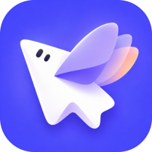
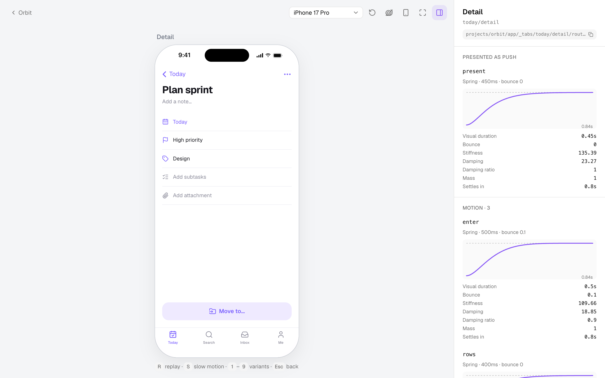
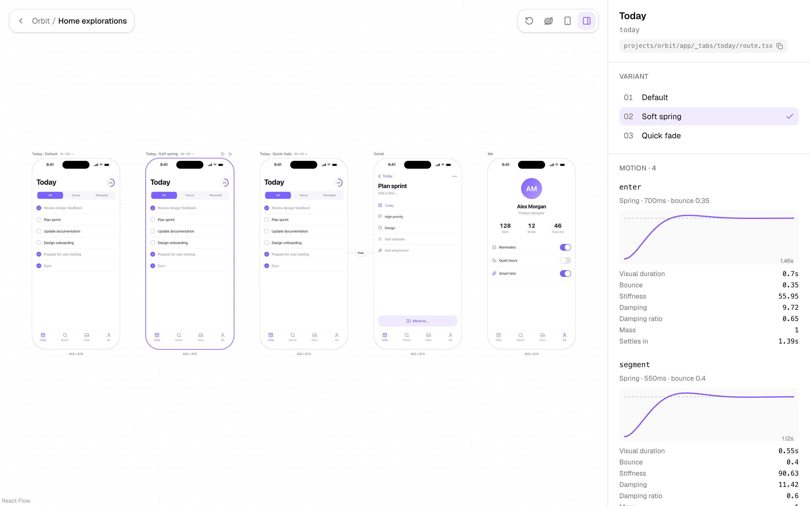
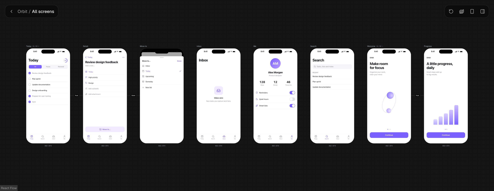
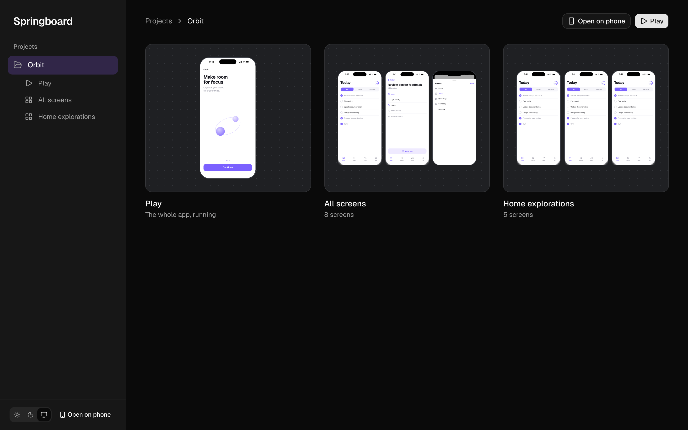

# Protoling

**Prototype mobile apps — screens, navigation and motion — in code.**

Protoling is an open-source starter for prototyping how a mobile app _works and moves_. Each prototype is a small app made of React screens and [TanStack Router](https://tanstack.com/router) routes, animated with [Motion](https://motion.dev). Protoling runs it on a phone frame at real device size, lets you tap through the whole app, compare animation variants side by side, open it full screen on your phone, and turn every timing into SwiftUI and Jetpack Compose code.

> **Status:** early development. Expect breaking changes.



---

## Why Protoling

Once the static design is done, the hardest part is still ahead: defining how the app behaves and moves. Building realistic interactions by dragging layers in a design tool is slow. In code, and especially with coding agents, it's fast.

So Protoling is **code-first**. You (or your agent) write the app. Protoling plays it, shows it, and hands it off. The goal is clear communication between design and engineering: show mobile developers exactly how an interaction looks and feels, with the values they need to rebuild it natively.

It runs entirely on your machine. There's no hosted version, no account and no database.

## Getting started

Requires [Bun](https://bun.sh) 1.2 or later.

```bash
git clone <repository-url> my-prototypes
cd my-prototypes
bun install
bun run dev
```

Open [http://localhost:3000](http://localhost:3000). The bundled **Orbit** project is a complete example: onboarding, a tab bar app, a pushed detail screen and a draggable sheet. Keep it as a reference or delete `projects/orbit` once you've added your own.

### On your phone

```bash
bun run dev:phone
```

This makes the dev server reachable on your local network. Click **Open on phone** and scan the QR code. The app fills the screen with no controls:

- **Three-finger tap** shows a menu for switching variants and exiting. Tap again to hide it.
- With a keyboard, **⌘ .** (or **Ctrl .**) toggles the menu; **Esc** closes it, then exits.

## How a prototype is built

```
projects/my-app/
  project.json              { "name": "My app", "device": "iphone-17-pro" }
  app/                      TanStack file routes, mounted at /my-app
    route.tsx               the app's root layout
    index.tsx               e.g. redirect to the first screen
    _tabs/route.tsx         a tab bar layout (pathless)
    _tabs/home/route.tsx    a screen at /my-app/home
    _tabs/home/detail.tsx   pushed from home: /my-app/home/detail
  boards/compare.ts         optional: app states side by side
  shared/                   components and data your screens share
```

Each project is a mini app inside Protoling. Its routes are ordinary TanStack Router files, so links and params are type-checked, and tools and agents that know TanStack already know how to write them.

### A screen

```tsx
// projects/my-app/app/_tabs/home/route.tsx
import { createFileRoute, useNavigate } from '@tanstack/react-router'
import { motion } from 'motion/react'
import { StackScreen, spring, tween, useMotion } from '@/runtime'

export const Route = createFileRoute('/my-app/_tabs/home')({
  staticData: {
    screen: {
      name: 'Home',
      motion: {
        enter: spring(0.45, 0.15), // visualDuration in seconds, bounce
      },
      variants: {
        'soft-spring': { name: 'Soft spring', motion: { enter: spring(0.7, 0.35) } },
        'quick-fade': { name: 'Quick fade', motion: { enter: tween(0.18, 'easeOut') } },
      },
    },
  },
  component: Home,
})

function Home() {
  const enter = useMotion('enter')
  const navigate = useNavigate()
  return (
    <StackScreen>
      <motion.h1 initial={{ opacity: 0, y: 16 }} animate={{ opacity: 1, y: 0 }} transition={enter}>
        Home
      </motion.h1>
      <button onClick={() => navigate({ to: '/my-app/home/detail' })}>Open detail</button>
    </StackScreen>
  )
}
```

- `staticData.screen` makes a route a **screen**: it gets a name, **motion tokens** and **variants**, and shows up on boards and in the inspector.
- `useMotion(key)` returns a ready-made Motion `transition` with the active variant and slow motion applied. Every token is graphed in the inspector and exported to SwiftUI and Compose.
- Variants are chosen in the URL (`?v=home:soft-spring`), so a link reproduces exactly what you saw. `useVariant()` lets a variant change structure as well as timing.

### Native-style navigation, from plain routes

Protoling doesn't ship a navigation library. A few pieces make TanStack routes behave like a native app:

| You write | You get |
| --- | --- |
| A nested child route with `staticData.presentation: 'push'` and a `transition` | An iOS-style push. The parent stays mounted underneath, with parallax and edge swipe-back. |
| `presentation: 'sheet'` | A sheet over the whole app, tab bar included. The app behind scales down; drag down to dismiss. |
| `presentation: 'fullScreen'` | A full-screen modal. |
| `useDismiss()` | Back: plays the presentation in reverse, then navigates. |
| A pathless layout with `useTabs({ … })` | A tab bar where each tab remembers its stack. |

The parent screen renders its content in `<StackScreen>`, which layers the matched child route on top.

### Runtime API

Everything comes from `@/runtime`:

| Export | Purpose |
| --- | --- |
| `spring(visualDuration, bounce)`, `tween(duration, ease)` | Motion tokens. |
| `useMotion(key)` | The token's Motion `transition` for the nearest screen. |
| `useVariant()` | `{ id, name, index, variants, setVariant }` for the nearest screen. |
| `StackScreen`, `useDismiss()` | Push, sheet and full-screen presentation, and dismissing. |
| `useTabs(roots)` | `{ active, select }` for a tab bar. |
| `useDevice()` | Device size, safe areas, and where the app is running. |
| `usePlayback()` | `{ playing, timeScale }`. Gate looping animations on `playing`. |
| `defineBoard({ name, frames })` | A curated board. |

### Layout inside the phone

A screen on a board is a 402 px box inside a desktop window, so `100vh` and viewport media queries would read the browser, not the phone. Inside a screen:

- Use `h-full` / `w-full`, flex, or container units (`cqw`, `cqh`). Every frame is a size container.
- Use the `--safe-top`, `--safe-bottom`, `--safe-left` and `--safe-right` CSS variables for insets. They match the device on desktop and use the real `env(safe-area-inset-*)` on a phone.
- `position: fixed` is contained by the frame.

## A look around

**Boards** put app states side by side. Here, three variants of the same screen run next to each other, and the inspector shows the selected variant's springs:



Every project also gets an **All screens** board, with arrows taken from its routes. Light, dark and system themes:





## Using Protoling

| Surface | What it's for |
| --- | --- |
| **Play** | The whole app on a phone frame. Tap through it like the real thing. The URL follows the app, so any state is a shareable link. |
| **Boards** | App states side by side, each one live. Every project gets **All screens** automatically; arrows show which screen presents which, taken from the routes. Curated boards (`boards/*.ts`) put, say, three variants of one screen next to each other. |
| **Inspector** | The screen on top: its variants, each motion token's curve and physics, how it's presented, and handoff code for Motion, SwiftUI and Compose. |
| **Phone** | The app full screen on a real device. |

### Shortcuts

| Key | Action |
| --- | --- |
| ⌘K | Command palette: jump to any screen or board, switch theme |
| R | Replay |
| S | Slow motion (4× slower) |
| 1–9 | Switch variant of the screen on top |
| I | Toggle the inspector |
| Shift 1 | Fit a board to the window |
| Esc | Leave play mode, or deselect on a board |

Slow motion applies to timings that come from `useMotion()` and presentation transitions. Transitions written as literals inside a screen run at normal speed.

## Working with coding agents

[AGENTS.md](AGENTS.md) explains the conventions to coding agents (Claude Code reads it through `CLAUDE.md`). It asks them to check their work with:

```bash
bun run snap my-app/home "my-app/home/detail?id=3"   # PNGs in snaps/
bun run snap my-app/home --frames 6                  # a strip of an animation
bun run snap my-app/home --device iphone-se
```

`snap` starts Protoling, renders each URL on a phone frame with your installed Chrome, and fails if the page throws.

## Handoff

The inspector computes native values from the same physics Motion runs; unit tests check them against Motion's own spring generator.

For a spring with `visualDuration` _d_ and `bounce` _b_ (mass 1):

| Platform | Code |
| --- | --- |
| SwiftUI | `.spring(duration: 1.2 × d, bounce: b)`. For negative bounce it exports exact `.interpolatingSpring(mass:stiffness:damping:)`, since the two libraries shape overdamped springs differently. |
| Jetpack Compose | `spring(dampingRatio = 1 − b, stiffness = (2π / 1.2d)²)` for bounce ≥ 0; exact values otherwise. |

Tweens export as cubic Béziers. Motion's `circ`, `backInOut` and `anticipate` easings aren't Béziers, so those are exported as the closest curve and flagged as approximate.

## Scripts

| Command | Description |
| --- | --- |
| `bun run dev` | Start Protoling at localhost:3000 |
| `bun run dev:phone` | Same, reachable from other devices on your network |
| `bun run snap <urls>` | Render app states to PNGs |
| `bun run build` | Typecheck and build a static copy of every project |
| `bun run preview` | Serve that build locally |
| `bun run test` | Unit tests (Vitest) |
| `bun run lint` | Lint and check formatting (Biome) |
| `bun run format` | Fix formatting |

## Tech stack

[Vite](https://vite.dev), [TanStack Router](https://tanstack.com/router), [React 19](https://react.dev), [Motion](https://motion.dev), [React Flow](https://reactflow.dev), [Tailwind CSS v4](https://tailwindcss.com) and [shadcn/ui](https://ui.shadcn.com), [Zustand](https://zustand.docs.pmnd.rs), [Shiki](https://shiki.style), [cmdk](https://cmdk.paco.me), [Biome](https://biomejs.dev), [Vitest](https://vitest.dev) and [Bun](https://bun.sh).

## Project structure

```
projects/              your prototypes (Orbit is the example)
src/
  runtime/             the API prototypes import from @/runtime
  components/app/      the host around every mini app: device, safe areas, phone menu
  components/          play, boards, inspector, shell, ui (shadcn)
  lib/                 devices, motion maths, handoff, boards, workspace
  routes/host/         Protoling's own pages
scripts/snap.ts        render app states to PNGs
docs/screenshots/      images used in this README
vite/                  project discovery and the read-only dev endpoint
```

## Contributing

Contributions are welcome: bug reports, ideas, docs and pull requests. Read the [contributing guide](CONTRIBUTING.md) to get set up, and please follow the [code of conduct](CODE_OF_CONDUCT.md). Report security problems privately, as described in the [security policy](SECURITY.md). Changes are listed in the [changelog](CHANGELOG.md).

## License

[MIT](LICENSE) © 2026 Synonymy
